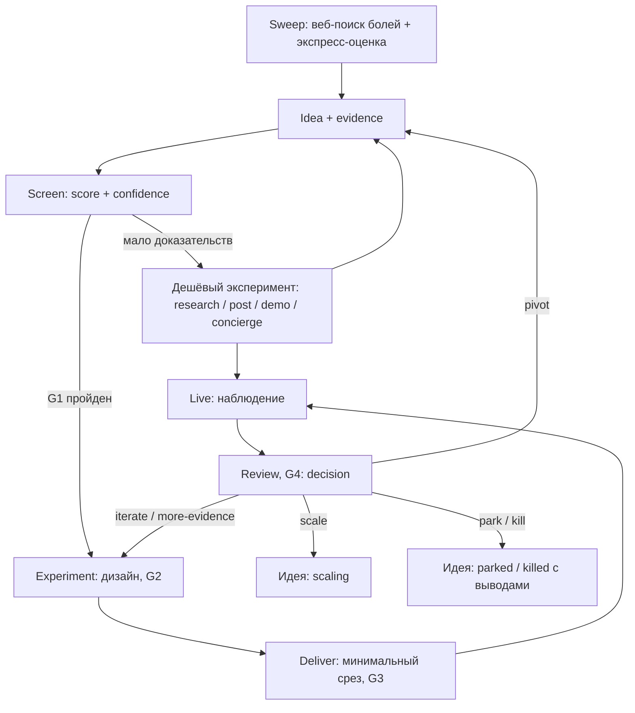

# Product Lab: система непрерывного поиска и проверки продуктовых идей

**Назначение:** повторяемый, project-agnostic процесс, который превращает наблюдаемые проблемы пользователей в приоритизированные идеи, недорогие production-эксперименты и решения на основе фактического поведения.

Система рассчитана на solo builder или небольшую команду, использующую coding agents для быстрого прототипирования. Она не требует обязательных интервью, отдельного лендинга или долгого discovery перед каждым MVP: доказательства могут приходить из публичных обсуждений, отзывов, собственных постов, concierge-проверок и аналитики уже работающего сервиса.

## Цикл

Термины на схеме (стадии, статусы, решения, gates G1–G4, лестница сигналов L0–L5) определены один раз — в [00-model](system/00-model.md).

## Как пользоваться

1. Раз в месяц (или когда пул идей мельчает) провести sweep: веб-поиск болей и экспресс-оценка; по прошедшим идеям собрать свидетельства — [10-discover](system/10-discover.md), [inbox](inbox.md), шаблоны [idea](templates/idea.md) и [evidence](templates/evidence.md).
2. По прошедшим экспресс-оценку — сразу дешёвый тест S, обычно outreach к авторам сигналов ([leads.base](leads.base)) — [30-experiment](system/30-experiment.md), шаблон [experiment](templates/experiment.md) с полями ★.
3. Перед тестом M/L или кодом — полный скоринг, выбор по времени до дохода и фильтры G1 — [20-screen](system/20-screen.md); спроектировать эксперимент и измерения до кода.
4. Если нужен код — со стартового шаблона реализовать минимальный срез и пройти [release checklist](templates/release-checklist.md) по уровню риска — [40-deliver](system/40-deliver.md). Оплата — только после релиза работающей функции.
5. Провести review и записать решение в тот же эксперимент — [30-experiment](system/30-experiment.md), § Review.

Сводка по идеям, экспериментам и доходности — [registry.base](registry.base), по лидам — [leads.base](leads.base). Новые заметки создаются из `templates/` (Obsidian: «Insert template»).

## Структура

- `system/` — правила: [00-model](system/00-model.md) (ядро и словарь), `10-discover`, `20-screen`, `30-experiment`, `40-deliver`; `modules/` — расширения для LLM.
- `templates/` — поля: `idea`, `evidence`, `experiment`, `lead`, `release-checklist`, `project`.
- `projects/<slug>/` — применение к продукту: карточка, `ideas/`, `experiments/`, `leads/`.

Стартовый шаблон для новых MVP ([40-deliver](system/40-deliver.md)) пока не выделен; источник — репозиторий anti-scope-creep, задача в [карточке проекта](projects/anti-scope-creep/README.md).

Правило: документ в `system/` объясняет «зачем» и задаёт правила, шаблон задаёт поля, проект хранит экземпляры. Список полей или чек-лист живёт только в шаблоне; документы на него ссылаются.

## Принципы

1. **Evidence before commitment, not necessarily before code.** Сначала требуются свидетельства проблемы и чёткая гипотеза, но прототип может быть частью исследования.
2. **Build fast; learn deliberately.** Скорость реализации полезна только тогда, когда можно понять результат.
3. **Popularity is not demand.** Лайки и просмотры слабее реальных действий, повторного использования и оплаты.
4. **One experiment, one primary question.** Не пытаться одним релизом проверить пять гипотез.
5. **Keep business value and portfolio value separate.** Технически интересный проект может быть полезен для портфолио, даже если его коммерческий потенциал невысок; не смешивать эти выводы.
6. **No evidence is an acceptable result.** Прекращение идеи после дешёвого эксперимента — нормальный исход, а не провал.
7. **LLM organizes evidence; it does not create evidence.** Любой важный вывод должен прослеживаться до реального источника или события продукта.
8. **Charge for working code only.** Оплата запрашивается только за реализованную и выпущенную функцию; до этого цену проверяют показом цены и waitlist.
9. **People before reach.** Первые пользователи приходят из прямого контакта с людьми, описавшими боль, а не из охвата постов.
10. **Production changes need guardrails.** Тесты, безопасность, приватность, откат и мониторинг важны даже при однодневной реализации.

## Как подключить новый проект

Создать `projects/<slug>/README.md` из шаблона [project](templates/project.md): ссылки на production и репозиторий, сегмент, известные риски, ссылки на технические источники истины в репозитории. Общие правила остаются в `system/`; детали продукта — в его папке, технические факты — в его репозитории.

## Гибкость

Это operating system, а не жёсткий календарь. Идея может пройти от сигнала к прототипу за день, если риск низкий и эксперимент измерим. Для чувствительных, юридических, финансовых или security-критичных функций требуется более строгая проверка независимо от скорости coding agent.
