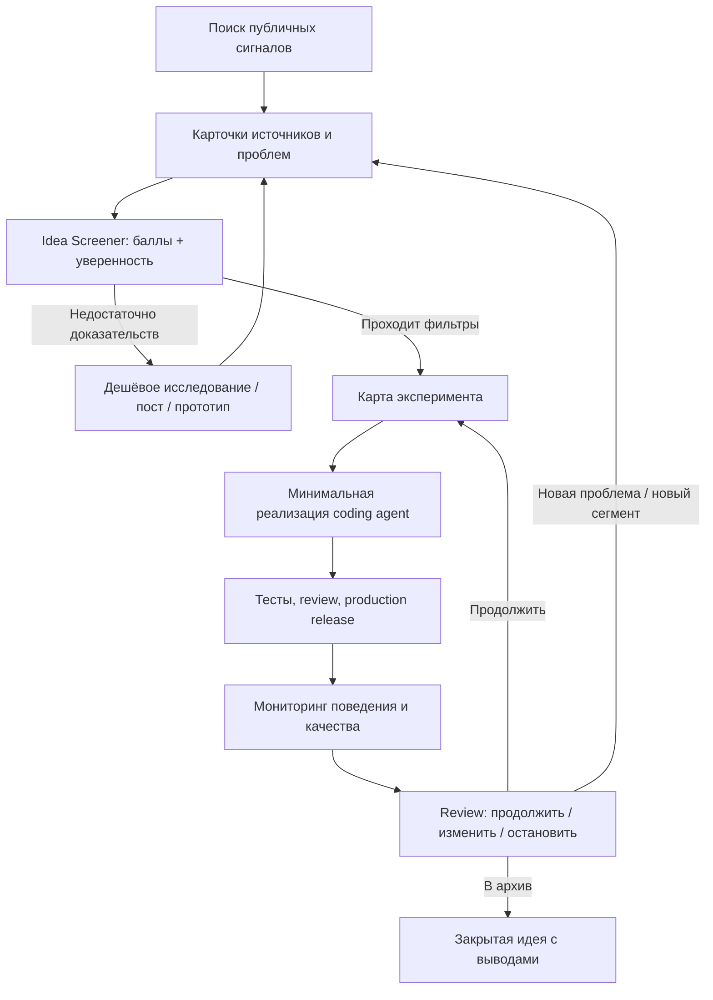

# Product Lab: система непрерывного поиска и проверки продуктовых идей

**Назначение:** повторяемый, project-agnostic процесс, который превращает наблюдаемые проблемы пользователей в приоритизированные идеи, недорогие production-эксперименты и решения на основе фактического поведения.

Система рассчитана на solo builder или небольшую команду, использующую coding agents для быстрого прототипирования. Она не требует обязательных интервью, отдельного лендинга или долгого discovery перед каждым MVP: доказательства могут приходить из публичных обсуждений, отзывов, собственных постов, concierge-проверок и аналитики уже работающего сервиса.

## Основной цикл

## С чего начать

1. Прочитать [Operating Model](docs/00-operating-model.md).
2. Использовать [Idea Discovery](docs/01-idea-discovery.md), чтобы искать реальные проблемы и собирать подтверждения.
3. Оценить идеи через [Idea Screener](docs/02-idea-screener.md).
4. Для каждой проходящей идеи заполнить [Experiment Brief](templates/experiment-brief.md).
5. Реализовать самый маленький проверяемый сценарий по [Agentic Delivery](docs/04-agentic-delivery.md).
6. Заранее настроить измерения по [Analytics & Monitoring](docs/05-analytics-and-monitoring.md).
7. Принять решение по [Decision Review](docs/06-decision-review.md).

## Структура

- `docs/00-operating-model.md` — процесс целиком, статусы и ритм работы.
- `docs/01-idea-discovery.md` — веб-исследование и сбор свидетельств.
- `docs/02-idea-screener.md` — рубрика оценки и обязательные фильтры.
- `docs/03-experiment-design.md` — проектирование дешёвых проверок спроса.
- `docs/04-agentic-delivery.md` — как использовать coding agents без накопления случайных функций.
- `docs/05-analytics-and-monitoring.md` — события, воронки, качество и приватность.
- `docs/06-decision-review.md` — правила решений после эксперимента.
- `docs/07-llm-assisted-research.md` — безопасное использование LLM для веб-исследования.
- `docs/08-llm-evaluation-data.md` — синтетические датасеты и оценка AI-функций.
- `templates/` — шаблоны для повторяющейся работы.
- `projects/anti-scope-creep/` — первое применение общей системы к Anti-Scope Creep.

## Принципы системы

1. **Evidence before commitment, not necessarily before code.** Сначала требуются свидетельства проблемы и чёткая гипотеза, но прототип может быть частью исследования.
2. **Build fast; learn deliberately.** Скорость реализации полезна только тогда, когда можно понять результат.
3. **Popularity is not demand.** Лайки и просмотры слабее реальных действий, повторного использования и оплаты.
4. **One experiment, one primary question.** Не пытаться одним релизом проверить пять гипотез.
5. **Keep business value and portfolio value separate.** Технически интересный проект может быть полезен для портфолио, даже если его коммерческий потенциал невысок; не смешивать эти выводы.
6. **No evidence is an acceptable result.** Прекращение идеи после дешёвого эксперимента — нормальный исход, а не провал.
7. **LLM organizes evidence; it does not create evidence.** Любой важный вывод должен прослеживаться до реального источника или события продукта.
8. **Production changes need guardrails.** Тесты, безопасность, приватность, откат и мониторинг важны даже при однодневной реализации.

## Как подключить новый проект

Скопировать шаблон проекта или создать `projects/<project-slug>/README.md`. Заполнить: ссылку на production и репозиторий, целевую аудиторию, текущий сценарий, известные риски, события аналитики, открытые гипотезы и решения. Общие правила остаются в `docs/`; детали конкретного продукта — в его папке.

## Как пользоваться документами

Эти документы описывают operating system, а не жёсткий календарь. Идея может пройти от сигнала к прототипу за день, если риск низкий и эксперимент измерим. Для чувствительных, юридических, финансовых или security-критичных функций требуется более строгая проверка независимо от скорости coding agent.
